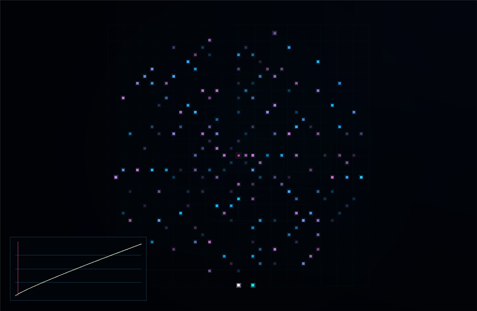
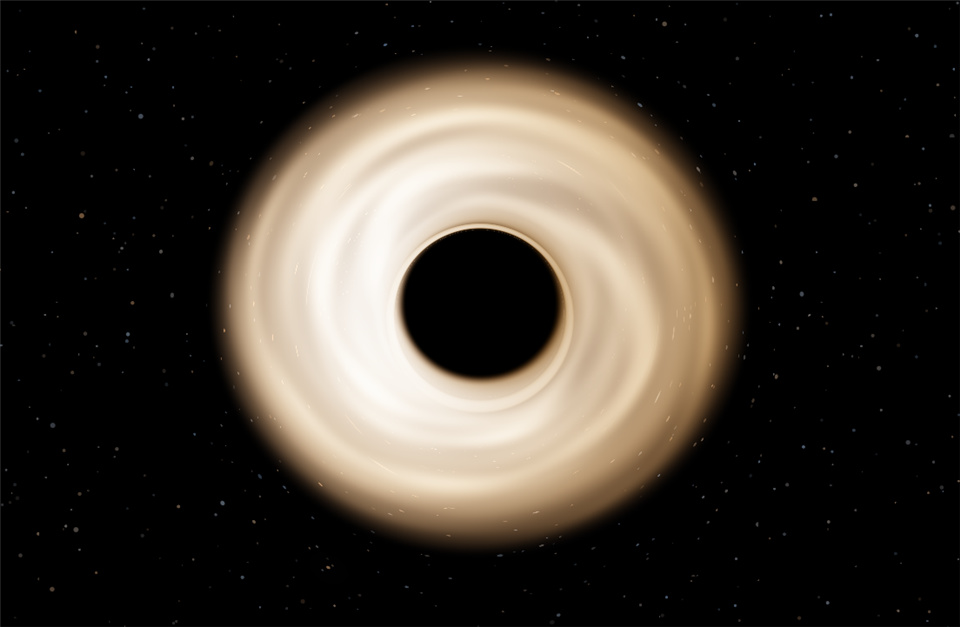
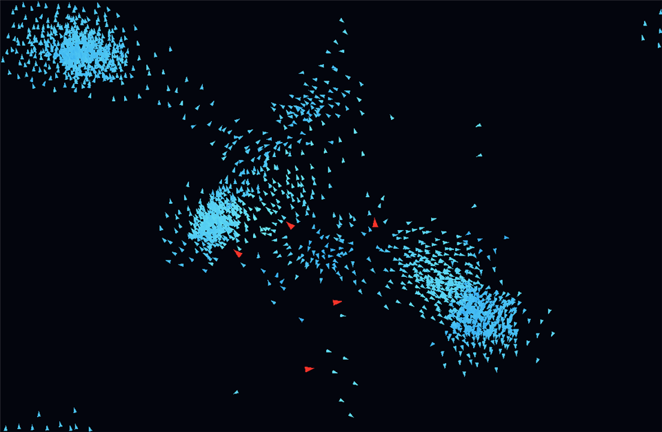
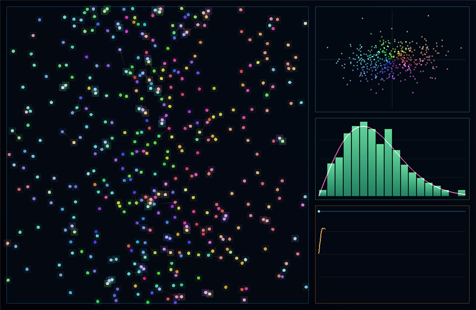

# Slowfield

*A quiet collection of slow generative fields for Windows.*

Slowfield will become one self-contained Windows screen saver, `slowfield.scr`.
It begins with four independent visual systems that are being consolidated into
one Rust application:

- **Prime Field** — an Ulam-prime spiral whose spacing follows the continuous
  natural-number frontier, with the exact prime-counting function \(\pi(n)\)
  compared with the logarithmic integral \(\operatorname{Li}(n)\).
- **Gravity Field** — a procedural Schwarzschild-style black-hole scene.
- **Flock Field** — a fixed-step predator/prey flocking simulation.
- **Boltzmann Field** — a bounded hard-disk gas visualisation with velocity
  statistics and coarse-grained entropy history.

## Gallery

Each image is an actual 5-second frame from the Windows live-preview mode.

| Prime Field | Gravity Field |
| --- | --- |
|  |  |
| Flock Field | Boltzmann Field |
|  |  |

The working default chooses one available field randomly at launch. The native
`/c` settings window permits choosing one fixed field and adjusting the
migrated Gravity/Flock controls. Boltzmann Field has no user-exposed controls:
it bounds its particle workload internally. The first consolidation release
does not change fields during an active saver session.

In full-screen saver mode, Slowfield renders on the Windows primary display.
Every other display is covered by a black, topmost background window; no second
OpenGL context or renderer is created for those displays. The saver is
per-monitor DPI aware so these windows align with mixed-scaling displays.

## Status

The repository is in a controlled migration. The active product source is the
Rust workspace. The original Prime Field, Gravity Field, and Flock Field
implementations now live under `legacy/` only as behavior references; they are
not built or shipped by Slowfield. Boltzmann Field is a native Slowfield scene.

The detailed migration sequence is tracked in
[issue #1](https://github.com/qink15b73/slowfield-screensaver/issues/1).

## Planned product contract

- one Windows process, one Win32 host, one OpenGL 3.3 compatibility context;
- standard `/s`, `/p <HWND>`, `/c`, `/w`, and `/d` modes;
- one per-user configuration schema with safe import from valid legacy values;
- no runtime shader, texture, model, DLL, network, or helper-executable
  dependency;
- bounded scene workloads and scene-specific frame policies; and
- one release artifact: `slowfield.scr`.

## Development build

The current Rust workspace validates product rules that do not need a Win32
window or GPU:

```bat
cargo fmt --check
cargo test --workspace
cargo clippy --workspace --all-targets -- -D warnings
```

The shared Windows host renders Prime Field, Gravity Field, Flock Field, and
Boltzmann Field. Boltzmann Field is a pedagogical hard-disk gas simulation, not
a numerical proof of the Boltzmann--Grad limit: its colour encodes current
velocity rather than particle species, and it caps its 60 Hz particle workload.
Its lower chart uses amber for the coarse-grained velocity entropy, and a cyan
baseline/marker for the logarithmically scaled relative kinetic-energy error.
Gravity embeds its canonical GLSL source at build time, uses the migrated
864-scene catalogue, and permits one GPU frame in flight. `legacy/` contains
historical builds but is not a Slowfield entry point.

Slowfield reads `HKCU\Software\Qink\Slowfield` schema v2 when it is
complete and valid. Otherwise it uses safe defaults and may read individually
valid controls from the former Gravity and Flock registry keys; it never edits
or removes those legacy keys.

## Repository layout

```text
legacy/                 Imported source retained for behavior comparison
  gravity-field/         Original Black Hole source and its historic tools
  boids-screensaver/    Archived Flock Field source
  ulam-screensaver/     Prime Field source without prior Git history
crates/                 Active Rust workspace source
docs/                   Architecture and provenance
```

## License and notices

Slowfield is MIT-licensed. Existing attribution for the initial Gravity Field
shader and the Flock Field reference is retained; see `LICENSE`, `NOTICE.md`,
and `docs/provenance.md`.
